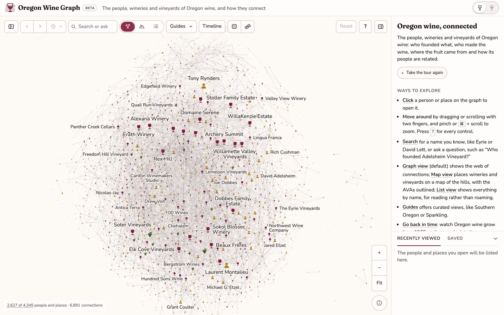
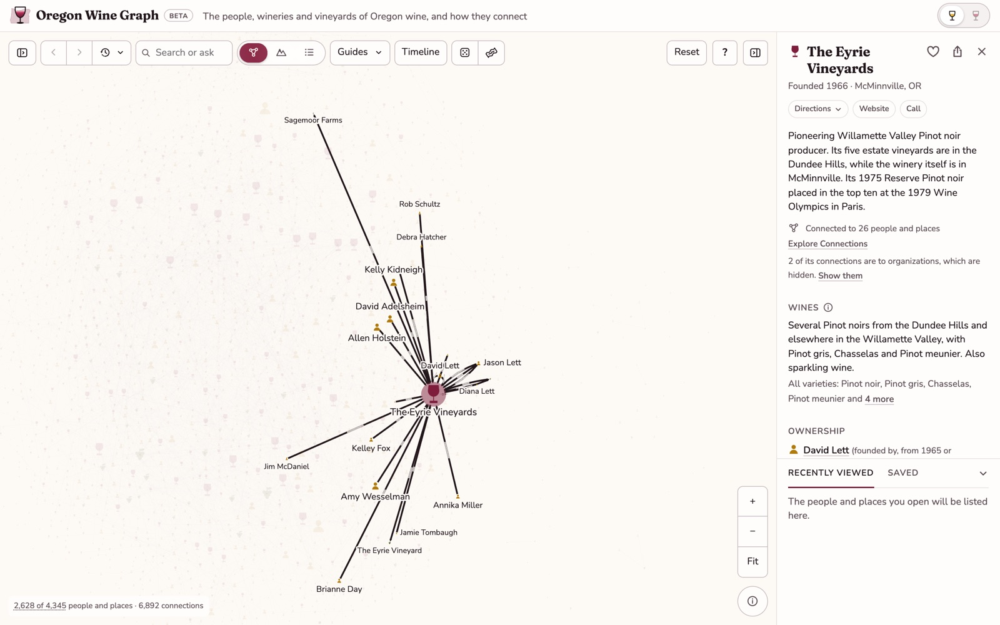
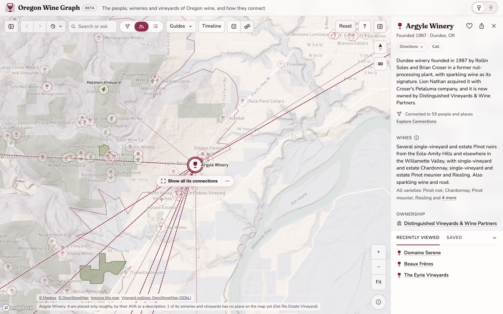
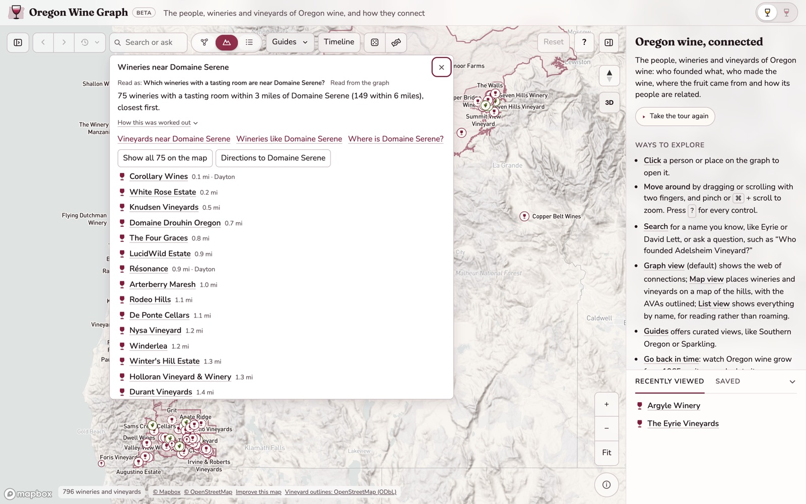
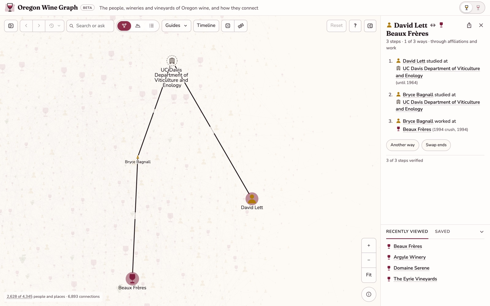
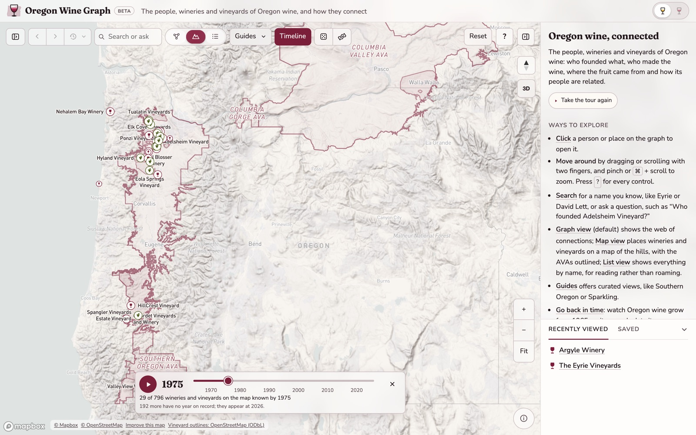
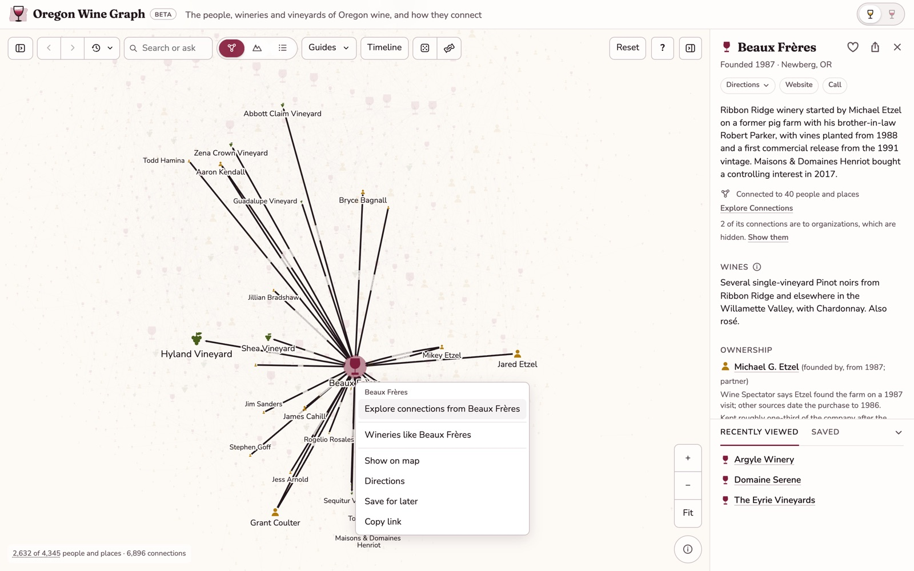
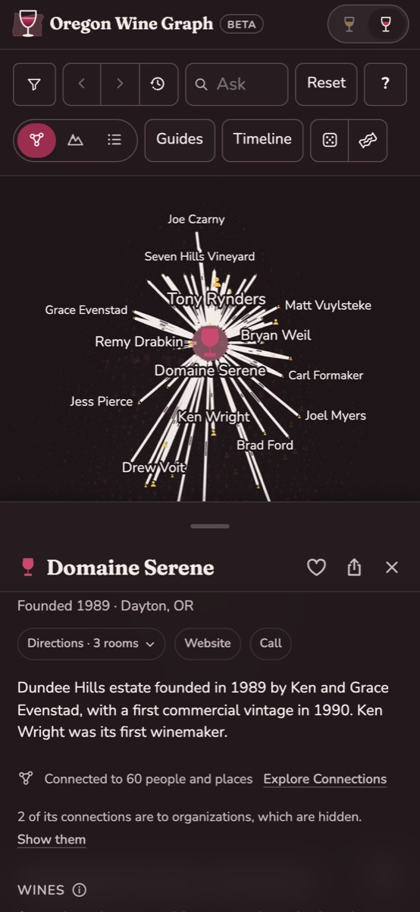
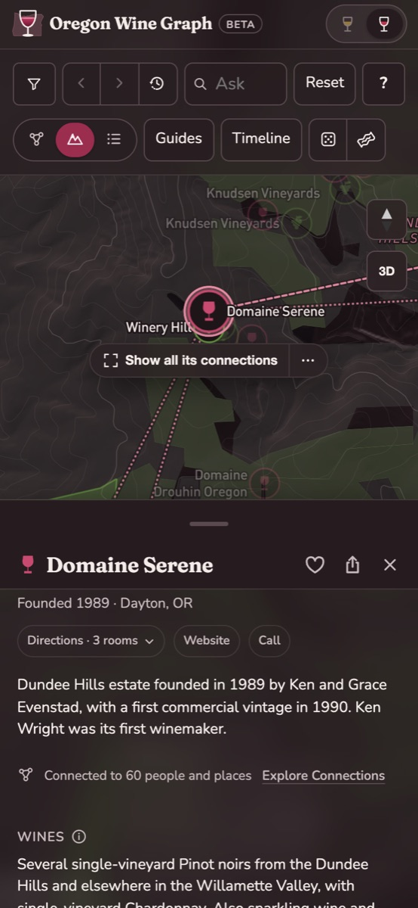

# Oregon Wine Graph

**[oregonwine.app](https://www.oregonwine.app)** is an explorable map of the people, wineries and vineyards behind Oregon wine, and how they connect: who founded what, who made the wine where, who trained whom, which vineyards supply which wineries, and how families and careers run through the industry from the 1960s pioneers to today.

This repository is the site's public companion. It holds:

- **[How it's made](METHODOLOGY.md):** where the facts come from, how each one is checked, and the rules the data follows.
- **[Changelog](CHANGELOG.md):** every release since the first version on 13 October 2026.
- **[Issues](../../issues):** report a wrong fact, a missing person or place, a problem with the site, or an idea.

The site's own code and data pipeline are not published here.

## What you can explore

### The graph

Every person, winery, vineyard, AVA, organization and event is a point, and every relationship between them is a line. Open one to see its story, its connections and the sources for each. A winery's card also gives its tasting rooms with directions, its website and phone, and a summary of the wines it makes, read from its federal label approvals.

### The map

Wineries at every tasting room they run, or where their wine is made. Vineyards are shown at their own sites and, where they're mapped, as outlines of the land under vine. The official AVA boundaries are drawn too, and lines show which vineyards supply which wineries. Opening a record zooms in to it; **Show all its connections** frames everything it's tied to.

### Ask

Search by name, or ask a question in plain words: "Wineries near Domaine Serene", "Who makes the most Pinot gris?", "Which vineyard sells to the most wineries?", "Wineries founded since 2010". Answers are read from the records, never made up, say how much of the graph they rest on, and can be shown on the graph or the map.

### Explore Connections

Name any two people or places to see the fewest steps between them, each step with its source. **Another way** shows the next path.

### Through the years

**Timeline** shows the graph or the map as it stood in any year. Press Play to watch Oregon wine grow from the 1960s.

### More to do with a record

Right-click a record on the graph, the map or in the list, or press and hold it on a phone, for a short menu: open it, wineries like it, tasting rooms nearby, the other view, directions, save it or copy its link. Right-click a connection line to see how its two ends connect.

### On a phone

The whole site works on a phone, with the record in a sheet under the graph or the map, and in light and dark.

  
  

### And

- **Guides,** curated views such as Southern Oregon or Sparkling, and a **list view** for reading everything by name, by keyboard or screen reader.
- **Saved and Recently viewed,** kept in your browser.
- **Oral histories.** Hundreds of people and places link to their interview in Linfield University's Oregon Wine History Archive.

Every record has its own address. For example, [oregonwine.app/the-eyrie-vineyards](https://www.oregonwine.app/the-eyrie-vineyards) opens straight to The Eyrie Vineyards.

## What's in it

As of 4 November 2026 (version 1.80):

| | Records |
|---|---|
| People | 2,476 |
| Wineries | 1,166 |
| Vineyards | 703 |
| Organizations | 425 |
| AVAs | 25 |
| Events | 17 |
| **Connections** | **13,540** |

Nearly nine in ten of these records are verified against their sources; [How it's made](METHODOLOGY.md) explains how.

Coverage is strongest for the northern Willamette Valley, where Oregon's modern wine industry began and where most published history concentrates. The Walla Walla Valley and the Rocks District, which share Oregon's border, are included with their people and places. Southern Oregon and the Columbia Gorge are thinner.

## Reporting a problem

[Open an issue](../../issues/new/choose) and pick the kind of report:

- **Correction:** a fact that's wrong, such as a name, a year, a role or a connection. Please include a published source if you can.
- **Missing:** a person, winery, vineyard or connection the site doesn't have.
- **Site problem:** something that doesn't work or looks wrong, with your device and browser.
- **Idea:** something you'd like the site to do.

Issues here are public. To report something privately, use **Flag** at the foot of any record on the site instead. Flags go only to the site's maintainer and are checked against the record's sources each morning.

The most useful sources are published and specific: an interview, a winery's own history page, or a news story or book that names the people and the years. Corrections that come with a source are checked and applied like any other record.

## Licence

The text in this repository is licensed under [Creative Commons Attribution 4.0](https://creativecommons.org/licenses/by/4.0/). Source material belongs to its publishers; the site links to each one.

## Thanks

With particular thanks to Linfield University's [Oregon Wine History Archive](https://oregonwinehistoryarchive.org), and to the writers, wineries and growers whose published work the site cites.
